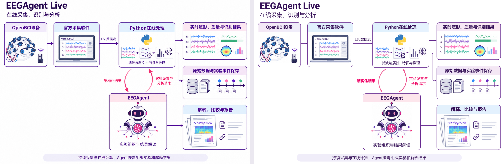
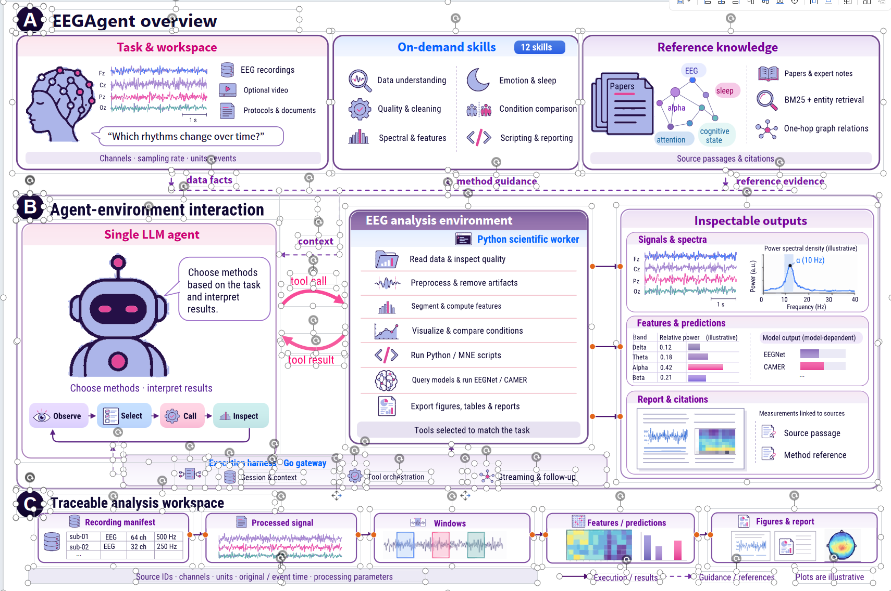

# Academic Image to Editable PPT

把参考图片转成可逐组件修改的 PowerPoint：**原生文字与结构 + 独立高清素材**。适用于论文架构图、系统图、流程图、截图、信息图和一般图片，也支持从图像 API 生成新素材后组装。

**禁止描摹任何位图。** 图标、插画、设备、照片和图表只允许从原资产无损抠取，或通过 Image API 生成后直接使用。自己生成的图片也不能再追踪成路径；不会用成千上万条粗糙曲线换取“全矢量”的说法。

## 实际转换对比

下图左侧是用户原图，右侧是最终 PPT 在 Microsoft PowerPoint 中实际导出的结果。图像素材保留原始像素与颜色；字体、框和箭头由原生对象组成。



[下载可编辑 PPTX](examples/live/EEGAgent-Live-editable.pptx?raw=true) · [查看单张预览](examples/live/preview.png) · [查看完整示例](examples/live)

这个示例含 **24 个原生文本框、24 个独立图片对象、7 个模块组**。4 条模块间直线已绑定；在副本中移动模块 12 pt，端点实际跟随 12 pt。24 份裁片与源图的保留像素一致，没有重采样、量化或路径描摹。[验证记录](examples/live/verification.json)保留实际结果。

## 可编辑到什么程度

| 内容 | 实际编辑能力 |
| --- | --- |
| 标题、正文、小标签 | 原生文本，可直接改字和字体 |
| 框、分区、表格、流程线 | 原生对象，可改布局、样式和连接关系 |
| 抠取或 API 生成的图标/插画/图表 | 独立高清图片，可移动、等比缩放、裁剪和替换 |
| 用户有真正的源矢量 | 可保留其原路径；不从位图追踪制造矢量 |

图片内部的笔画不是原生曲线节点。需要内部节点编辑时应使用真实源矢量，不能牺牲画质强制描摹。也不会把整图贴底再覆盖几个文字框，冒充分组件重建。

以下是用户提供的组件编辑参考。当前流程强调保留高清图片素材，并把文字和结构单独原生化。



## 安装到 Codex

仓库名为 `academic-image-to-editable-ppt`，技能调用名为 `image-to-editable-ppt`。

```powershell
git clone https://github.com/khalil-wu/academic-image-to-editable-ppt.git "$env:USERPROFILE/.codex/skills/image-to-editable-ppt"
python -m pip install -r "$env:USERPROFILE/.codex/skills/image-to-editable-ppt/requirements.txt"
```

在 Codex 中调用：

```text
$image-to-editable-ppt 把这张图片转成PPTX。素材只能无损抠取或通过图像API生成，禁止描摹，保持清晰度；文字、模块和连线原生编辑。
```

技能入口：[SKILL.md](SKILL.md)。这是供 Codex 执行的工作流程和辅助脚本，需要先分析参考图、确定组件和场景；不是一条命令就能恢复任意位图的源文件。

## 工作流程

1. **识别内容和逻辑**：逐字核对标签，记录模块、汇合、反馈和阅读顺序。
2. **识别字体**：优先源文件元数据；只有位图时比较候选字形，明确是视觉近似。
3. **选择素材来源**：允许沿用原图就无损抠取；要求原创则实际调用指定 Image API，不伪造生成记录。
4. **保留清晰度**：素材保留原像素和透明度，不描摹、不量化、不降采样；分辨率不足时换高清源或重新生成对应素材。
5. **重建组件**：文字、框、表格和箭头原生建立；素材独立嵌入、按语义分组。
6. **实际验收**：目标应用导出完整图和局部，检查图片质量、字体、逻辑与可编辑性，再交付。

有字的电脑屏幕不会整块冻结成图片。示例中先把外壳裁片的屏幕内部设为透明，文字原生重建，波形和控件分别无损取回。

## 复现示例

在仓库根目录执行：

```powershell
python -m pip install -r requirements.txt
python examples/live/rebuild.py
```

得到 `examples/live/output/figure.pptx` 和审计记录。复现使用已整理的场景与裁片，不请求 API，也不描摹。

该示例的底层命令为：

```powershell
python scripts/build_native_layout.py examples/live/scene.json examples/live/output/layout.pptx
python scripts/insert_assets_pptx.py examples/live/output/layout.pptx examples/live/assets.json examples/live/output/with-assets.pptx
python scripts/group_and_connect.py examples/live/output/with-assets.pptx examples/live/scene.json examples/live/output/figure.pptx
python scripts/audit_pptx.py examples/live/output/figure.pptx --expect examples/live/scene.json --assets-report examples/live/output/with-assets.assets.json --output examples/live/output/audit.json
```

## 脚本

| 脚本 | 用途 |
| --- | --- |
| `crop_assets.py` | 原像素裁图、局部透明清除，保存来源记录 |
| `insert_assets_pptx.py` | 把原始素材字节嵌入为独立图片，不重采样 |
| `build_native_layout.py` | 从场景生成原生文字、结构和流程底稿 |
| `group_and_connect.py` | 语义分组与直线端点绑定 |
| `match_font.py` | 比较 TTF/OTF/TTC 候选，提供视觉近似匹配 |
| `patch_latin_font.py` | 另存并替换西文字体槽，保留中文和几何 |
| `audit_pptx.py` | 核对文字、独立素材、来源、像素与连接关系 |

生成新图标时使用当前可用的图像生成工具；如采用用户指定的 API/模型，遵循其调用方式，只读取本机配置，密钥不进入仓库或提示词。

## 质量边界

位图不能证明原始字体、曲线控制点和图表底层数据。字体匹配是近似；图表保留其可见原图，不编造实验数据。源图本身很低清时，裁剪不能凭空增加细节，应寻找高清源或按任务要求重新生图。

生成与结构检查可跨平台运行；示例的实际视觉/编辑验收使用 Windows Microsoft PowerPoint，相关验证需要本机安装 Office。普通导出的位图预览不能替代编辑性测试。

## 许可证

代码使用仓库的 [Apache License 2.0](LICENSE)。示例图和用户提供的编辑截图用于展示转换流程。
