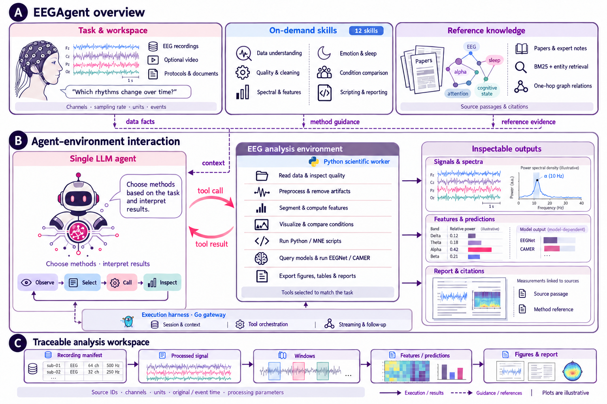
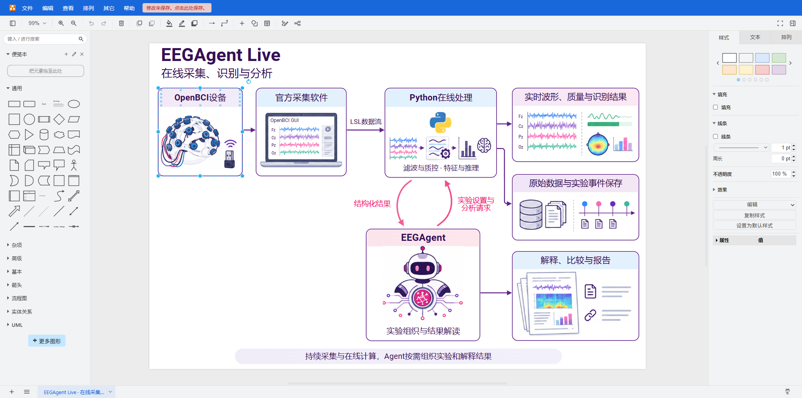

# Academic Image to Editable PPT & draw.io

将论文图、流程图、截图等图片转换为可编辑 PowerPoint 或 draw.io，也支持已有 PPTX 转 draw.io。

文字、模块框和连线原生编辑；图标、插画和图表采用无损抠取或 API 生成，作为独立高清素材使用。生成模型可由用户指定，如 Sunburst、Nano Banana、GPT Image 等。

## 效果对比

右侧使用用户提供的 PowerPoint 编辑截图，显示独立对象的选择框与控制点。

| 原图 | PowerPoint 编辑状态 |
| :---: | :---: |
| [](docs/images/overview-source.png) | [](docs/images/overview-editing.png) |

[总览可编辑 PPTX](examples/overview/EEGAgent-overview-editable.pptx?raw=true) · [下载 Live 示例 PPTX](examples/live/EEGAgent-Live-editable.pptx?raw=true) · [查看 Live 预览](examples/live/preview.png)

| Live 原图 | draw.io 编辑状态 |
| :---: | :---: |
| [](examples/live/preview.png) | [](docs/images/live-drawio-editing.png) |

[下载可编辑 draw.io](examples/drawio/EEGAgent-Live-editable.drawio?raw=true)。已实测改字、模块移动、连线跟随及保存后重新打开；图像素材可独立移动和替换。

## 安装

```powershell
git clone https://github.com/khalil-wu/academic-image-to-editable-ppt.git "$env:USERPROFILE/.codex/skills/image-to-editable-ppt"
python -m pip install -r "$env:USERPROFILE/.codex/skills/image-to-editable-ppt/requirements.txt"
```

## 使用

在 Codex 中附上图片并调用：

```text
$image-to-editable-ppt 把这张图转成PPTX和drawio，保留布局与清晰度，素材只抠取或用API生成，不描摹。
```

复现仓库示例：

```powershell
python examples/live/rebuild.py
python examples/drawio/rebuild.py
```

[详细工作流程](SKILL.md) · [draw.io 转换说明](references/drawio.md) · [Apache-2.0](LICENSE)
